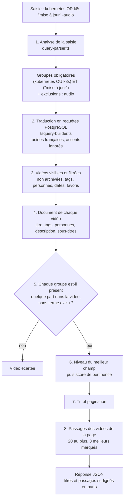
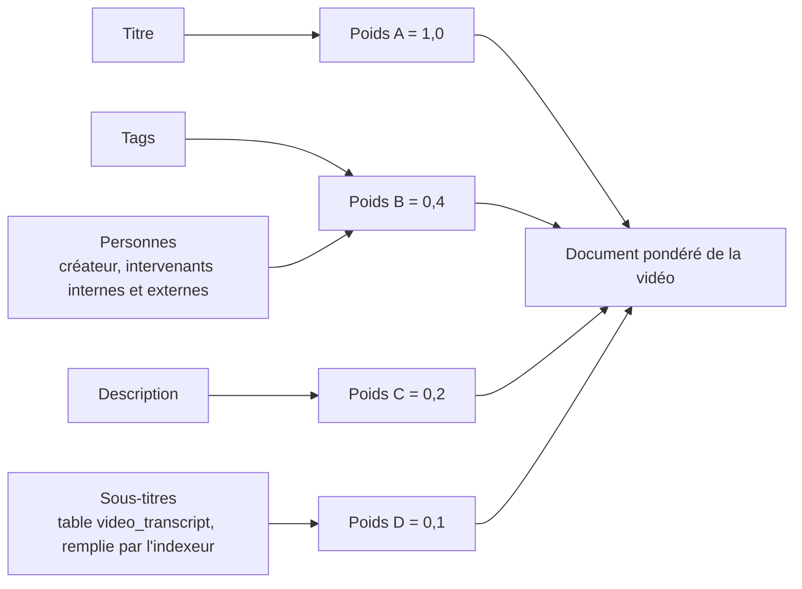
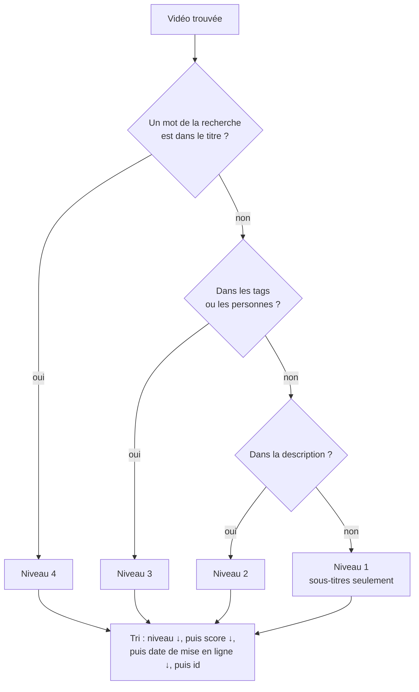
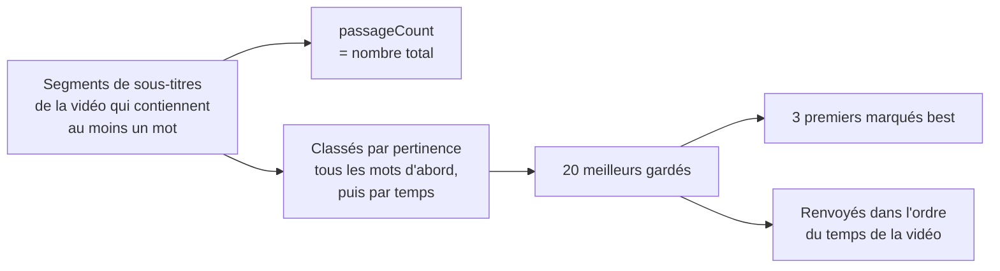

# Recherche par contenu : comment les résultats sortent

Ce document explique **quelles vidéos sortent** pour une recherche, **dans quel ordre**, et **quels passages** sont affichés sous chacune. Il décrit le code de ce dossier (`GET /api/search` et `GET /api/videos/:id/transcript`). Le design complet est dans `docs/superpowers/specs/2026-11-12-recherche-par-contenu-design.md` (section 6.4).

Tout se passe dans PostgreSQL, avec sa recherche plein texte native. Le code SQL est dans `infra/postgres-search.gateway.ts`.

## Vue d'ensemble



Sans mot-clé (`q` absent ou blanc), seules les étapes 3 et 7 s'appliquent : la page liste les vidéos filtrées, **les plus récentes d'abord**, sans score ni passage.

## 1. Analyse de la saisie

La saisie (200 caractères au plus) est découpée en **groupes obligatoires** et en **exclusions**. 10 mots ou expressions au plus, exclusions et alternatives comprises.

| Saisie | Effet |
|---|---|
| `kubernetes sauvegardes` | Deux groupes : la vidéo doit contenir les deux mots. |
| `ffmpeg or rgpd` | Un seul groupe à deux alternatives : l'un **ou** l'autre suffit (`or`, quelle que soit la casse). |
| `"données personnelles"` | Une expression : les mots doivent se suivre, dans cet ordre. |
| `-audio` ou `-"prise de son"` | Exclusion : une vidéo qui contient ce terme n'apparaît pas. |
| `& \| ! : * ( ) < >` | Retirés : ils n'ont pas de sens dans notre syntaxe. |

Un guillemet non fermé est ignoré. Une saisie qui ne contient que des exclusions, ou que des caractères retirés, ne renvoie rien.

## 2. Comment deux mots « correspondent »

Chaque texte est découpé en mots, puis chaque mot est réduit à sa racine française, sans accents ni majuscules (configuration `ochocast_fr`). Deux mots correspondent s'ils ont la même racine.

| Recherche | Trouve | Pourquoi |
|---|---|---|
| `conférences` | conférence, Conférence | même racine |
| `ecole` | école | accents ignorés |
| `kubernets` | kubernetes | même racine |
| `kubrnetes` | rien | pas de correction des fautes de frappe en V1 |
| `le`, `de`, `et` seuls | rien | mots vides, ignorés |

## 3. Quelles vidéos peuvent sortir

Avant toute correspondance, la recherche ne garde que les vidéos visibles par la personne connectée :

- les vidéos **archivées** sont exclues. Un admin peut demander `archived=true` : il ne voit alors **que** les vidéos archivées. Pour une autre personne, `archived=true` renvoie `403` ;
- puis les filtres facultatifs : tags, personnes (créateur ou intervenant interne, par nom, prénom ou pseudo, **jamais par e-mail**), période, favoris.

## 4. Le document d'une vidéo

Chaque vidéo est vue comme un seul document, où chaque champ a un poids :



Les sous-titres ne comptent que s'ils correspondent aux sous-titres **actuels** de la vidéo (`video_transcript.subtitle_key = video_entity.subtitle_id`). Des sous-titres remplacés et pas encore réindexés sont ignorés.

## 5. Correspondance : la vidéo sort-elle ?

Une vidéo sort si **chaque groupe obligatoire est présent quelque part** dans son document, et si **aucune exclusion** n'y est. Les groupes peuvent être dans des champs différents : `kubernetes sauvegardes` trouve une vidéo dont le titre contient « Kubernetes » et dont les sous-titres parlent de « sauvegardes ».

## 6. L'ordre des résultats

Le tri par défaut (`sort=relevance`) applique **quatre clés, dans cet ordre strict** :



1. **Niveau** : le meilleur champ où apparaît au moins un mot ou une expression de la recherche. Un titre bat toujours le reste, **quel que soit le score**. Une vidéo qui a « gyroscope » dans son titre passe devant une vidéo qui le dit 15 fois dans ses sous-titres.
2. **Score**, à niveau égal : `ts_rank_cd` sur le document pondéré. Il augmente avec le nombre d'occurrences, leur poids et leur proximité. **+0,2** quand tous les mots de la recherche sont présents sous leur forme exacte (sans réduction à la racine), soit dans les informations (titre, tags, personnes, description), soit dans les sous-titres : `conférences` met devant les vidéos qui disent « conférences » plutôt que « conférence ».
3. **Date** de mise en ligne, la plus récente d'abord.
4. **Identifiant**, pour que deux pages ne se chevauchent jamais.

Avec `sort=recent`, seules la date puis l'identifiant comptent.

### Exemple, avec le jeu de données de test

Recherche `ffmpeg or rgpd` :

| Rang | Vidéo | Champs trouvés (`matchedIn`) | Niveau |
|---|---|---|---|
| 1 et 2 | « Transcoder ses vidéos avec FFmpeg » et « RGPD et IA générative : ce qui change en 2026 » | contient `title` | 4 : départagées par le score |
| 3 | « Déployer une plateforme vidéo sur Kubernetes » | `description`, `transcript` | 2 |

La vidéo sur Kubernetes sort aussi, parce que sa description et ses sous-titres parlent de FFmpeg. Elle passe après, puisque le mot n'est pas dans son titre.

## 7. Les passages affichés sous une vidéo



- Un passage est un segment du fichier de sous-titres (un « cue » WebVTT), avec son début et sa fin en secondes.
- `passageCount` compte **tous** les segments trouvés. `passageTotal` en fait la somme sur toutes les vidéos trouvées, pas seulement la page.
- Un segment est retenu s'il contient au moins un mot ou une expression de la recherche. Il est classé selon sa pertinence pour toute la recherche : les segments qui contiennent tous les mots passent devant, puis l'ordre du temps départage.
- Seuls les **20 meilleurs** segments d'une vidéo sont renvoyés, dans l'ordre du temps. Les **3 meilleurs** ont `best: true` : ce sont ceux que la page de résultats montre en premier.
- Les exclusions écartent des vidéos entières, pas des passages.
- Les passages ne sont calculés que pour les vidéos de la page demandée.

## 8. Le surlignage

PostgreSQL marque les mots trouvés (`ts_headline`) avec deux caractères de contrôle, que le backend découpe en morceaux :

```json
"titleParts": [
  { "text": "Déployer une plateforme vidéo sur ", "hit": false },
  { "text": "Kubernetes", "hit": true }
]
```

Le front affiche ces `parts` comme du texte. **Aucun HTML n'est renvoyé**, ce qui écarte toute injection. Le titre n'est surligné que si la recherche y est trouvée.

## 9. Limites

- Toute la recherche (vidéos puis passages) partage un budget de **2 secondes**. Au-delà, l'API répond `503` avec un message qui invite à mettre moins de mots.
- Pas de correction des fautes de frappe ni de recherche par le sens en V1 (prévus en V1.1 et V2, section 12 du design).
- Les sous-titres sont pris en compte une fois indexés : à la fin du transcodage, après la génération des sous-titres automatiques, ou avec la commande `search:reindex`.
