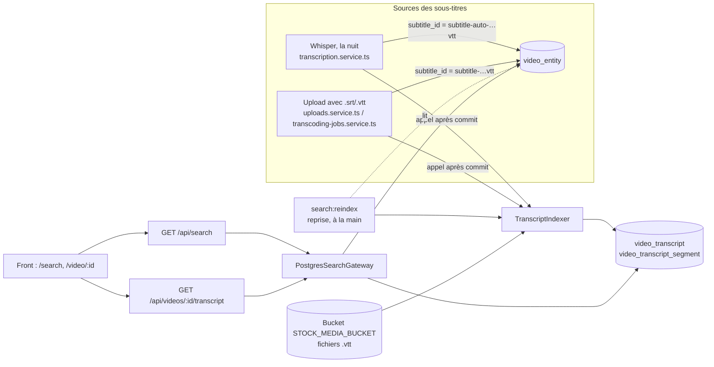

# Recherche dans le contenu des vidéos — design V1

- **Date :** 12 novembre 2026
- **Statut :** cadrage, maquette et choix technique validés par le client. Ce document a été validé par l’équipe le 12 novembre 2026 pour passer au plan d’implémentation.
- **Branche de référence :** `origin/main` au commit `87474bea`.
- **Lecteurs visés :** l’équipe OchoCast et les agents IA qui implémenteront les lots de la section 9. Chaque lot doit pouvoir être pris sans relire la conversation de cadrage.

## 1. Intention

Aujourd’hui, la barre de recherche d’OchoCast ne trouve une vidéo que par ses informations (titre, description, tags, créateur, intervenants), et seulement par une sous-chaîne exacte, dans le navigateur, sans classement. Depuis la PR #183, chaque vidéo reçoit des sous-titres français générés la nuit par Whisper : le contenu parlé existe, mais personne ne peut chercher dedans.

La V1 permet de taper des mots-clés, « comme sur Google », et d’obtenir :

- les vidéos qui contiennent ces mots dans leurs informations **ou dans ce qui est dit** ;
- classées par pertinence ;
- avec, pour chaque vidéo, **les passages** où les mots sont prononcés, horodatés, mots surlignés ;
- un clic sur un passage ouvre la vidéo **à cet instant**, avec la transcription à côté du lecteur.

Le comportement attendu est celui de la maquette validée par le client. Elle est versionnée avec ce document : `assets/2026-11-12-recherche-par-contenu/` contient la source, les captures et la liste des écarts entre la maquette et la V1. Une version en ligne, privée, est aussi disponible : <https://claude.ai/artifact/1tSgfaUH4aKcZRP8jw8Mtb>. Les écrans sont décrits en section 5 ; le jeu de données de la maquette est reproduit en annexe A.

## 2. Objectifs, non-objectifs, anti-objectifs

### Objectifs V1

1. Recherche par mots-clés dans : titre, description, noms des tags, créateur (prénom, nom, nom d’utilisateur), intervenants internes (prénom, nom), intervenants externes (texte libre), sous-titres.
2. Syntaxe : mots simples (tous requis), `"expression exacte"`, `-mot` pour exclure, `or` (ou `OR`) entre deux termes pour l’un ou l’autre.
3. Français : pluriels et conjugaisons ramenés à leur racine (« conférences » trouve « conférence »), accents ignorés (« ecole » trouve « école »), apostrophes d’élision ignorées (« l’école » trouve « école »).
4. Un mot doit être présent quelque part dans la vidéo, pas forcément dans le même champ : `kubernetes sauvegardes` trouve une vidéo dont le titre contient « Kubernetes » et dont un passage parle de « sauvegardes ».
5. Classement par ordre **strict** de champ : titre > tags, créateur et intervenants > description > sous-titres. Dans un même niveau, la plus pertinente, puis la plus récente. Tri alternatif « Plus récentes ».
6. Pour chaque vidéo : badges « Trouvé dans » (Titre, Tags, Intervenants, Description, Transcription), les 3 meilleurs passages affichés dans l’ordre chronologique, « Voir les N autres passages » pour le reste.
7. Lien profond vers un instant : `/video/:id?t=<secondes>&q=<requête>`.
8. Page vidéo :
   - panneau « Transcription » à côté du lecteur : ligne en cours surlignée pendant la lecture, clic sur une ligne pour s’y rendre, recherche dans la vidéo avec occurrences précédente / suivante ;
   - sous le lecteur, une **barre des passages** : un repère cliquable par passage trouvé, avec le curseur de lecture.

   Les deux sont adaptés au mobile, à la tablette et à l’ordinateur.
9. Les filtres existants de la page de recherche continuent de marcher : tags, utilisateurs, dates, favoris, archivées (admin).
10. Les sous-titres sont indexés tout seuls : sous-titres automatiques de la nuit, sous-titres fournis à l’upload, et toutes les vidéos qui ont déjà des sous-titres (reprise de l’existant).

### Non-objectifs (V1)

- Tolérance aux fautes de frappe et suggestion « Vouliez-vous dire » : **V1.1** (extension `pg_trgm`).
- Recherche par le sens (synonymes, reformulations) : **V2** (extension `pgvector`, voir section 12).
- Autres langues que le français. La V1 prépare cependant le terrain (colonne `language`, configurations nommées par langue) ; voir section 12.
- Recherche dans le contenu des événements : la recherche des événements reste celle d’aujourd’hui.
- Résultats au fil de la frappe (autocomplétion).
- Lecteur vidéo maison. On garde react-player et ses contrôles natifs (`controls`), qu’on ne peut pas décorer. Les repères des passages sont donc dans une barre séparée, sous la vidéo (section 5.3).
- Statistiques de recherche.

### Anti-objectifs (échec même si « ça marche »)

- Une vidéo archivée visible dans les résultats d’un utilisateur non administrateur.
- L’e-mail d’un créateur utilisable comme critère de recherche (il l’est dans l’endpoint actuel `searchvideo`, il ne doit pas l’être dans le nouveau).
- Des résultats qui ne reflètent pas l’état de la base : vidéo supprimée encore trouvée, titre modifié pas pris en compte, ancien sous-titre encore cherché après remplacement.
- Du HTML injectable via un titre, une description ou un sous-titre (les extraits surlignés ne sont jamais rendus avec `dangerouslySetInnerHTML`).
- Une requête de recherche qui ralentit le reste de l’application (base partagée entre l’API et le staging).

## 3. Contraintes

- **Base de données :** Scaleway Managed PostgreSQL **15**, nœud DB-DEV-S (2 vCPU, 2 Go de RAM, 10 Go de disque). Bases `rdb` (production) et `rdb_staging` sur la même instance. PostgreSQL 15 arrive en fin de vie chez Scaleway le 11 novembre 2027.
- **Pas de nouveau service à héberger.** Tout tient dans PostgreSQL et le backend NestJS existant. Seules des solutions sous licence libre sont acceptées.
- **Volume prévu :** 10 h de vidéo publiées par mois, soit ≈ 84 000 mots et ≈ 7 000 lignes de sous-titres par mois, ≈ 250 000 lignes après 3 ans. Mesure locale : ≈ 3,7 Mo par mois en base, index compris.
- **Extensions :** `unaccent` (V1) et `pg_trgm` (V1.1) sont disponibles et « trusted » sur la base managée. L’utilisateur de l’application a le droit `CREATE` (vérifié le 12 novembre 2026, section 11, point 1). `vector` (pgvector 0.8.2, pour la V2) est disponible mais **pas** « trusted » : en V2, il faudra l’activer par la console Scaleway.
- **TypeORM :** en développement et dans l’e2e de la CI, `synchronize` est actif (`backend/src/config/typeorm.config.ts`, `database.config.ts`) et aucune migration ne tourne. En production, les migrations tournent au démarrage du conteneur (`backend/Dockerfile`, `npm run migration:run:prod`). Sur une base construite par `synchronize`, `npm run migration:run` rejoue toutes les migrations depuis la première et échoue. Conséquences :
  - les nouvelles tables (colonnes générées `tsvector`, configurations de recherche) ne sont **pas déclarées comme entités TypeORM**, pour que `synchronize` ne les touche pas ;
  - le SQL de création est écrit de façon **idempotente** (`IF NOT EXISTS`, blocs `DO` pour les configurations) dans une fonction partagée, par exemple `ensureSearchSchema(queryRunner)` ;
  - la migration de production appelle cette fonction ;
  - le module de recherche l’appelle aussi au démarrage **quand `synchronize` est actif** (développement, e2e). Ainsi, la base locale et celle de la CI ont les tables sans étape manuelle.
- **Plusieurs réplicas du backend** peuvent tourner (HPA Kubernetes) : l’indexation d’une vidéo prend un verrou PostgreSQL par vidéo (section 6.3).
- **Architecture hexagonale** du backend (`backend/HexArch.md`) : le moteur de recherche est derrière un port (`SearchGateway`) pour pouvoir changer d’implémentation plus tard sans toucher au domaine ni au front.
- **Lecteur :** react-player 2 avec les contrôles natifs (`frontend/src/pages/videoMedia/videoMedia.tsx`, vers la ligne 700) ; `seekTo` est déjà utilisé (ligne 632).

## 4. Décisions déjà prises

Prises avec le client ou l’équipe pendant le cadrage, à ne pas rouvrir dans ce lot :

| Décision | Origine |
|---|---|
| Moteur : recherche plein texte native de PostgreSQL (`tsvector`, configuration française + `unaccent`) sur la base existante | Comparatif des solutions, validé par le client |
| Pas de moteur dédié (OpenSearch, Typesense…) ni de service SaaS en V1 | Idem |
| Recherche par le sens via `pgvector` en V2 seulement, avec un modèle libre | Idem |
| Interface : celle de la maquette validée (résultats avec passages, lien vers l’instant, panneau de transcription) | Client |
| Périmètre : vidéos seulement ; événements inchangés ; e-mail retiré des champs cherchés ; archivées réservées aux administrateurs ; filtres actuels conservés | Proposition « périmètre V1 » validée avec le cadrage |
| Fautes de frappe : pas en V1 ; suggestion « Vouliez-vous dire » en V1.1 | Idem |

## 5. Expérience utilisateur

### 5.1 Barre de recherche (en-tête)

Inchangée dans son fonctionnement : la saisie puis Entrée mène à `/search?q=…` avec les filtres existants dans l’URL (`tags`, `users`, `dateFrom`, `dateTo`, `favoris`, `archived`). Nouveau paramètre : `sort=relevance|recent` (défaut `relevance`).

Au focus, quand le champ est vide, un menu propose des exemples de syntaxe (« "expression exacte" · -mot pour exclure · or pour l’un ou l’autre »). Les exemples de requêtes de la maquette sont du contenu de démo : en production, on n’affiche que la ligne d’aide sur la syntaxe.

### 5.2 Page de résultats `/search`

Structure de la page actuelle (`frontend/src/pages/globalSearch/globalSearch.tsx`) conservée : surtitre « Recherche globale », titre « Résultats pour « … » », pastilles de compteurs, section Événements puis section Vidéos.

- **Compteurs :** événements trouvés, vidéos trouvées, et nouveau compteur « N passages dans les sous-titres ».
- **Tri :** boutons « Pertinence » / « Plus récentes », reflétés dans `sort`.
- **Section Événements :** inchangée (filtrage côté navigateur comme aujourd’hui).
- **Section Vidéos :** une carte par vidéo :
  - miniature avec badges vues et durée, comme les vignettes actuelles ;
  - titre, mots trouvés surlignés ;
  - méta : créateur · date relative · intervenants ;
  - « Trouvé dans : » suivi de badges, dont « Transcription · N passages » ;
  - jusqu’à 3 passages : pastille horodatée « ▶ 12:34 » + extrait entre guillemets, mots surlignés ; chaque passage est un lien vers `/video/:id?t=<début>&q=<requête>` ;
  - « Voir les N autres passages » / « Afficher moins de passages » quand il y en a plus de 3 ;
  - clic sur la miniature ou le titre : `/video/:id?q=<requête>` (début de la vidéo).
- **Pagination :** 20 vidéos par page, bouton « Afficher plus de vidéos ».
- **Aucun résultat :** « Aucune vidéo ne correspond à « … ». » et des conseils (vérifier l’orthographe, mot plus général, retirer un terme exclu). Pas de suggestion en V1.
- **Sans mot-clé, avec des filtres** (par exemple `/search?favoris=true` ou `/search?tags=…`, que l’en-tête produit aujourd’hui) : la page garde son comportement actuel. Elle liste les vidéos filtrées, de la plus récente à la plus ancienne, sans passages, sans badges « Trouvé dans » et sans surlignage. Les données viennent de la même API (section 6.5).
- **Sans mot-clé ni filtre :** comportement actuel.
- **États :** chargement, erreur réseau (message et bouton Réessayer).

### 5.3 Page vidéo `/video/:id`

- `?t=754` : une fois le lecteur prêt, la vidéo est positionnée à 754 s, sans lecture automatique (les navigateurs la bloquent avec le son). Un bandeau temporaire (≈ 4,5 s) indique « Lecture à 12:34 · passage trouvé pour « … » » quand `q` est présent.
- **Panneau Transcription**, à droite du lecteur sur écran large, en dessous sur mobile :
  - surtitre « Transcription · générée automatiquement » (ou « fournie » si le sous-titre a été déposé à l’upload) ;
  - champ « Rechercher dans cette vidéo », prérempli avec `q` ;
  - compteur « 2 / 3 » et boutons occurrence précédente / suivante, qui positionnent la vidéo sur le passage ;
  - liste des lignes : horodatage + texte, mots trouvés surlignés ;
  - la ligne en cours de lecture est mise en évidence et suivie (défilement automatique, désactivé si `prefers-reduced-motion`) ;
  - clic sur une ligne : la vidéo se positionne à son début.
- **Barre des passages**, directement sous le lecteur, sur toute sa largeur :
  - **Affichage :**
    - elle n’apparaît que s’il y a au moins un passage trouvé, pour `q` ou pour la recherche du panneau ;
    - elle représente toute la durée de la vidéo ;
    - un repère par passage, placé à `start / durée` ;
    - un curseur de lecture qui avance avec la vidéo ;
    - le repère du passage en cours est mis en évidence.
  - **Interactions :**
    - un clic ou un appui sur un repère positionne la vidéo au début du passage, et la ligne correspondante devient active dans le panneau ;
    - sur ordinateur, le survol d’un repère affiche une info-bulle « 12:34 · extrait » ;
    - sur écran tactile, il n’y a pas de survol : l’appui positionne directement ;
    - chaque repère est un `<button>` avec `aria-label` « Aller à 12:34 : <extrait> », et il est atteignable au clavier.
  - **Densité :**
    - la zone de clic de chaque repère fait au moins 44 × 44 px sur écran tactile, même si le trait affiché est fin ;
    - les repères trop proches pour respecter cette taille sont regroupés en un seul repère avec un compteur (« 3 ») ;
    - un appui sur un groupe positionne au premier passage du groupe ;
    - aucun repère n’en chevauche un autre.
  - **Plein écran :** en plein écran natif, la barre n’est pas visible. C’est accepté : le panneau et les repères sont là en sortant du plein écran.
- Vidéo sans transcription : le panneau affiche « Transcription en préparation » si `transcription_status` est `pending` ou `processing`, sinon il est masqué. La barre des passages est masquée.
- Lien « ← Retour aux résultats pour « … » » quand on arrive depuis la recherche.

### 5.4 Textes

Toutes les nouvelles chaînes passent par i18next, en français et en anglais (`frontend/src/locales/fr|en/translation.json`).

### 5.5 Appareils

Les nouveaux écrans fonctionnent sur **mobile, tablette et ordinateur**. Viewports de référence pour les tests :
- mobile : 375 × 812 (portrait) et 812 × 375 (paysage) ;
- tablette : 768 × 1024 (portrait) et 1024 × 768 (paysage) ;
- ordinateur : 1440 × 900.

Comportements :
- **Résultats :** la carte passe en une colonne sous 600 px (miniature au-dessus, texte dessous). Les passages restent lisibles sans défilement horizontal. Les pastilles horodatées et les liens « Voir les N autres passages » ont une zone de clic d’au moins 44 px de haut.
- **Page vidéo :**
  - au-delà de 1024 px de large, le lecteur et sa barre des passages sont à gauche, le panneau Transcription à droite ;
  - en dessous, le panneau passe sous la barre des passages, avec une hauteur limitée (environ 50 % de l’écran) et son propre défilement.
- **Barre des passages :** même comportement partout ; seuls la zone de clic et le regroupement varient (section 5.3).
- **Toutes tailles :** pas de défilement horizontal de la page ; les champs de recherche ne déclenchent pas de zoom automatique sur iOS (police d’au moins 16 px dans les champs).

## 6. Architecture

### 6.1 Vue d’ensemble



Le principe : **le fichier de sous-titres (`subtitle_id`) reste la source de vérité.** Un indexeur lit ce fichier et en tire deux tables de recherche. Il est appelé dès qu’un sous-titre est posé ; une commande de reprise, lancée à la main, indexe l’existant. Les informations de la vidéo (titre, tags, personnes, description) ne sont **pas recopiées** : elles sont lues en direct à chaque recherche. Rien ne peut donc diverger sauf le contenu des sous-titres, que l’indexeur réconcilie lui-même.

### 6.2 Données

Une migration TypeORM (`backend/src/migrations/<timestamp>-AddContentSearch.ts`) écrite à la main en SQL, sur le modèle de `1791540000000-AddAutomaticTranscription.ts` :

```sql
CREATE EXTENSION IF NOT EXISTS unaccent;

-- Français : élision, mots vides, racinisation Snowball, accents ignorés.
CREATE TEXT SEARCH CONFIGURATION ochocast_fr (COPY = french);
ALTER TEXT SEARCH CONFIGURATION ochocast_fr
  ALTER MAPPING FOR hword, hword_part, word WITH unaccent, french_stem;

-- Forme exacte (sans racinisation), accents ignorés : noms propres, sigles.
CREATE TEXT SEARCH CONFIGURATION ochocast_exact (COPY = simple);
ALTER TEXT SEARCH CONFIGURATION ochocast_exact
  ALTER MAPPING FOR hword, hword_part, word WITH unaccent, simple;

-- Une ligne par vidéo indexée : l’état de l’indexation et le texte complet.
CREATE TABLE video_transcript (
  video_id      uuid PRIMARY KEY REFERENCES video_entity(id) ON DELETE CASCADE,
  subtitle_key  varchar NOT NULL,            -- valeur de subtitle_id indexée
  source        varchar NOT NULL,            -- 'auto' | 'provided'
  language      varchar(8) NOT NULL DEFAULT 'fr',  -- code ISO 639-1 ; toujours 'fr' en V1 (section 12)
  segment_count integer NOT NULL,
  tsv_fr        tsvector NOT NULL,           -- texte complet, poids D
  tsv_exact     tsvector NOT NULL,
  indexed_at    timestamptz NOT NULL DEFAULT now()
);

-- Une ligne par ligne de sous-titre.
CREATE TABLE video_transcript_segment (
  video_id  uuid NOT NULL REFERENCES video_entity(id) ON DELETE CASCADE,
  position  integer NOT NULL,                -- ordre dans le fichier, à partir de 0
  start_s   real NOT NULL,
  end_s     real NOT NULL,
  text      text NOT NULL,
  tsv_fr    tsvector GENERATED ALWAYS AS (to_tsvector('ochocast_fr', text)) STORED,
  tsv_exact tsvector GENERATED ALWAYS AS (to_tsvector('ochocast_exact', text)) STORED,
  PRIMARY KEY (video_id, position)
);
CREATE INDEX idx_vts_tsv_fr ON video_transcript_segment USING gin (tsv_fr);
```

`down()` supprime les deux tables et les deux configurations, mais **pas** l’extension `unaccent` (une autre partie de la base pourrait s’en servir plus tard).

Notes :

- `to_tsvector(regconfig, text)` avec une configuration nommée est IMMUTABLE : utilisable dans une colonne générée. `unaccent()` appelée seule ne l’est pas ; c’est pourquoi on passe par une configuration.
- `video_transcript.tsv_fr` est construit par l’indexeur avec `setweight(to_tsvector('ochocast_fr', <texte complet>), 'D')`. Au-delà d’environ 2 h de parole, PostgreSQL plafonne les positions à 16 383 : la correspondance reste juste, seule la recherche d’expression exacte au-delà de ce point devient approximative **dans ce vecteur** (les segments, eux, restent exacts).

### 6.3 Indexation des sous-titres

Nouveau module backend `search` (domaine + infra), avec un service `TranscriptIndexer`. Il expose `indexVideo(videoId)`, qui indexe une vidéo (étapes 3 et 4 ci-dessous), et `reindexAll()`, qui sert à la reprise.

**Au fil de l’eau.** Le backend appelle `indexVideo(videoId)` aux trois endroits où il pose `subtitle_id` :
- upload sans transcodage : `uploads.service.ts`, vers la ligne 409 ;
- fin de transcodage : `transcoding-jobs.service.ts`, lignes 199 et 238 ;
- transcription automatique : `transcription.service.ts`, après l’`UPDATE … RETURNING` de la ligne 180.

L’appel a lieu **après** la validation de la transaction qui écrit `subtitle_id`, et sans en attendre le résultat : un échec d’indexation ne fait échouer ni l’upload, ni le transcodage, ni la transcription. On n’indexe pas au moment exact où le `.vtt` est écrit dans le bucket : avec la file de transcodage, c’est le worker FFmpeg qui l’écrit, et le backend ne l’apprend qu’à la fin du job.

**Pas de tâche planifiée.** La reprise passe par une commande lancée à la main, `search:reindex`, qui appelle `reindexAll()`. Elle suit le modèle de `backend/scripts/backfill-transcription.ts` et s’exécute dans le pod backend, comme le script `transcription-batch`. On la lance :
- une fois après le premier déploiement de L2 sur chaque environnement, pour indexer les vidéos qui ont déjà des sous-titres ;
- ensuite, seulement après un incident.

Elle est idempotente : une seconde exécution ne change rien.

**`reindexAll()`** :

1. Vidéos à (ré)indexer : `subtitle_id` non vide **et** `transcoding_status = 'ready'` **et** (pas de ligne `video_transcript` **ou** `video_transcript.subtitle_key <> subtitle_id`). Traitées par lots de 20, les plus récentes d’abord.

   Pourquoi `transcoding_status = 'ready'` : quand la file de transcodage est active (staging, production), `uploads.service.ts:394` écrit `subtitle_id = subtitle-<id>.vtt` dès l’upload, mais le fichier n’existe à cette clé qu’une fois le worker terminé. Avant, l’objet est absent ; ce n’est pas un échec. Une vidéo dont le transcodage a échoué (`failed`) n’est pas indexée.
2. Vidéos à nettoyer : ligne `video_transcript` existante mais `subtitle_id` vide → suppression de leurs lignes.
3. Pour chaque vidéo (c’est exactement ce que fait `indexVideo`) : lire l’objet `subtitle_id` dans `STOCK_MEDIA_BUCKET` (refuser au-delà de 4 Mo, la limite d’upload actuelle), analyser le WebVTT, puis **dans une seule transaction** : supprimer les anciens segments, insérer les nouveaux, faire un upsert de `video_transcript`.
4. En cas d’échec (objet absent, fichier illisible, zéro ligne) : rien n’est écrit, et l’ancienne indexation éventuelle reste en place. Une journalisation `error` nomme la vidéo, la clé et la cause. Après correction, relancer `search:reindex`.
5. À la fin, la commande affiche le nombre de vidéos indexées, nettoyées et en échec.

**`source`** : `auto` si `subtitle_id` commence par `subtitle-auto-`, sinon `provided`. **`language`** : `'fr'` en V1. Le nom de la configuration de recherche est toujours obtenu par une correspondance langue → configuration, jamais écrit en dur (section 12).

**Détection d’un changement :** l’indexeur compare uniquement la clé (`subtitle_id` contre `subtitle_key`). Aucun chemin actuel ne réécrit un sous-titre à la même clé (`modifyVideo` ne gère pas les sous-titres). Règle pour toute fonctionnalité future qui remplacerait un sous-titre : elle écrit le nouveau fichier sous une **nouvelle clé**, ou bien elle supprime la ligne `video_transcript` de la vidéo dans la même transaction que la mise à jour de `subtitle_id`.

**Analyseur WebVTT** (fonction pure, testée unitairement) :

- ignore l’en-tête `WEBVTT`, les blocs `NOTE`, `STYLE`, `REGION` et les identifiants de cue ;
- lit `hh:mm:ss.mmm --> hh:mm:ss.mmm` et `mm:ss.mmm --> mm:ss.mmm`, ignore les réglages de position après les horodatages ;
- joint les lignes d’un même cue par une espace, retire les balises (`<v Nom>`, `<c>`, `<i>`, `<b>`, horodatages internes) et décode les entités `&amp; &lt; &gt; &nbsp;` ;
- ignore les cues vides ; tolère `\r\n`.

Les sous-titres produits par `toWebVtt` (`backend/src/transcription/webvtt.ts`) et ceux convertis depuis `.srt` à l’upload (`uploads.service.ts`, lignes 341 à 394) doivent tous deux passer.

**Deux indexations simultanées d’une même vidéo** restent possibles : commande de reprise pendant un appel direct, ou fin de transcodage signalée deux fois. `indexVideo` prend donc un verrou transactionnel par vidéo (`pg_advisory_xact_lock(<espace dédié>, hashtext(video_id::text))`) et relit `subtitle_id` dans sa transaction. La seconde indexation attend la première, puis ne refait rien si la clé est déjà à jour.

**Limite assumée :** sans tâche planifiée, un appel perdu laisse la vidéo sans passages jusqu’au prochain `search:reindex`. Cela arrive par exemple si le backend plante entre la validation et l’indexation, ou si le stockage est en panne. L’erreur est journalisée, pour qu’on le voie.

### 6.4 Requête de recherche

#### Analyse de la requête (côté application)

Un analyseur pur (testé unitairement) découpe la saisie en :

- **groupes requis** : un mot simple → `{ any: [mot] }` ; `a or b` → `{ any: [a, b] }` ; `"une expression"` → `{ phrase: "une expression" }` ;
- **termes exclus** : `-mot`.

Règles :

- `or` / `OR` entre deux termes (insensible à la casse) ; ailleurs, c’est un mot ordinaire.
- Un `-` en début de mot exclut ; ailleurs (« porte-monnaie »), il fait partie du mot.
- Les guillemets non fermés sont ignorés.
- Saisie limitée à 200 caractères et 10 groupes ; au-delà, l’API répond 400.
- Une saisie non vide sans groupe requis (uniquement des exclusions, ou uniquement des mots vides comme « le ») ne renvoie aucun résultat, sans erreur.
- Sans saisie (`q` absent ou vide) : **mode filtres seuls**. Pas de `tsquery` ; seuls les filtres s’appliquent ; tri par `createdAt` décroissant ; pas de passages, de `matchedIn` ni de surlignage.

Chaque groupe devient un `tsquery` construit **par paramètres SQL**, jamais par concaténation de texte : `plainto_tsquery('ochocast_fr', $n)` pour un mot, `phraseto_tsquery('ochocast_fr', $n)` pour une expression, combinés avec `||` (or), `&&` (et) et `!!` (non). On obtient :

- `q_all` = conjonction des groupes requis, et négation de chaque terme exclu ;
- `q_any` = disjonction de tous les groupes requis (sert aux extraits et au surlignage) ;
- `q_exact` = même construction que `q_all` avec la configuration `ochocast_exact` (bonus de forme exacte).

#### Correspondance au niveau de la vidéo

Une vidéo correspond si `doc @@ q_all`, où `doc` est calculé en direct :

```sql
setweight(to_tsvector('ochocast_fr', coalesce(v.title, '')), 'A')
|| setweight(to_tsvector('ochocast_fr', coalesce(<noms des tags>, '')), 'B')
|| setweight(to_tsvector('ochocast_fr', coalesce(<créateur + intervenants>, '')), 'B')
|| setweight(to_tsvector('ochocast_fr', coalesce(v.description, '')), 'C')
|| coalesce(vt.tsv_fr, ''::tsvector)          -- déjà en poids D
```

- `<créateur + intervenants>` = prénom, nom et nom d’utilisateur du créateur, prénom et nom des intervenants internes, `external_speakers`. **Jamais l’e-mail.**
- Les exclusions s’appliquent à toute la vidéo (un `-mot` présent dans n’importe quel champ ou passage l’écarte).
- Avec quelques centaines de vidéos, calculer `doc` à chaque requête est acceptable (voir le critère de performance, section 8). Si le critère n’est pas tenu, le builder peut matérialiser la partie métadonnées ; ce n’est pas demandé en V1.

#### Filtres et droits

- `v.archived = false`, sauf pour un administrateur qui demande `archived=true` (uniquement les archivées). Un non-administrateur qui envoie `archived=true` reçoit 403.
- Les vidéos en cours de traitement ou dont le traitement a échoué restent trouvables par leurs informations, comme aujourd’hui. Elles n’ont simplement pas encore de passages.
- Est administrateur l’utilisateur courant dont `user_entity.role = 'admin'`, comme dans `deleteVideo.usecase.ts`.
- `tags` : liste de noms de tags ; la vidéo doit porter au moins l’un d’eux (comparaison sans casse ni accents).
- `users` : liste de noms ; la vidéo correspond si le créateur ou un intervenant interne correspond (nom d’utilisateur, prénom, nom ou « prénom nom », sans casse ni accents), comme le filtre actuel.
- `dateFrom`, `dateTo` : bornes inclusives sur `createdAt`.
- `favoris=true` : uniquement les favoris de l’utilisateur courant.

#### Classement

L’ordre par champ est **strict** (décision de l’équipe du 12 novembre 2026). Une vidéo qui a le mot dans son titre passe toujours devant une vidéo qui ne l’a que dans ses sous-titres, même prononcé quinze fois.

```
niveau = 4 si le titre correspond à q_any
         3 sinon si les tags ou les personnes correspondent
         2 sinon si la description correspond
         1 sinon (correspondance par les sous-titres seulement)
score  = ts_rank_cd('{0.1, 0.2, 0.4, 1.0}', doc, q_any)
       + 0.2 si <métadonnées ou un segment> @@ q_exact
tri    : niveau décroissant, puis score décroissant, puis createdAt décroissant   (sort=relevance)
         createdAt décroissant                                                    (sort=recent)
```

Les coefficients de `score` départagent les vidéos d’un même niveau. Le builder peut les ajuster, à condition que les critères d’ordre de la section 8 restent vrais.

#### Passages

Pour chaque vidéo de la page de résultats :

- segments de la vidéo tels que `tsv_fr @@ q_any` ;
- `passageCount` = leur nombre ;
- on en garde au plus 20 : les mieux classés par `ts_rank_cd(tsv_fr, q_all_sans_exclusions)`, puis par `start_s` ;
- les 3 meilleurs portent `best: true` ; la liste est renvoyée **dans l’ordre chronologique**.

#### Surlignage

`ts_headline('ochocast_fr', text, q_any, 'HighlightAll=true, StartSel=<U+0002>, StopSel=<U+0003>')`, puis découpage côté serveur en `parts: [{ text, hit }]`. Le front affiche ces morceaux comme du texte, jamais comme du HTML. Même traitement pour le titre de chaque résultat.

Comportements vérifiés sur PostgreSQL 15.19 :
- le mot d’origine est surligné, avec ses accents ;
- pour une expression entre guillemets, `ts_headline` surligne aussi les mots de l’expression présents ailleurs dans la ligne. C’est accepté en V1.

#### Garde-fous

La requête de recherche s’exécute avec `SET LOCAL statement_timeout = '2s'` dans sa transaction. Au-delà, l’API répond 503 avec un message lisible.

### 6.5 API

Toutes les routes sont authentifiées, comme le reste de l’application (garde Keycloak global, `backend/src/keycloak.module.ts`).

#### `GET /api/search`

Paramètres de requête :

| Paramètre | Type | Défaut |
|---|---|---|
| `q` | texte, 0 à 200 caractères | vide = mode filtres seuls (section 6.4) |
| `tags` | noms séparés par des virgules | — |
| `users` | noms séparés par des virgules | — |
| `dateFrom`, `dateTo` | dates ISO 8601 | — |
| `favoris` | `true` / `false` | `false` |
| `archived` | `true` / `false` (admin) | `false` |
| `sort` | `relevance` / `recent` | `relevance` |
| `limit` | 1 à 50 | 20 |
| `offset` | ≥ 0 | 0 |

Réponse 200 :

```json
{
  "query": "kubernetes",
  "total": 1,
  "passageTotal": 3,
  "videos": [
    {
      "video": {
        "id": "uuid",
        "title": "Déployer une plateforme vidéo sur Kubernetes",
        "miniature_id": "…",
        "duration": 2712,
        "views": 42,
        "createdAt": "2026-11-07T10:00:00Z",
        "creator": { "id": "uuid", "username": "demo", "firstName": "…", "lastName": "…" },
        "speakers": ["Camille Martin"],
        "tags": ["kubernetes", "devops", "scaleway"]
      },
      "titleParts": [
        { "text": "Déployer une plateforme vidéo sur ", "hit": false },
        { "text": "Kubernetes", "hit": true }
      ],
      "matchedIn": ["title", "tags", "transcript"],
      "score": 1.23,
      "passageCount": 3,
      "passages": [
        { "start": 95.0, "end": 101.2, "best": true,
          "parts": [{ "text": "On a choisi ", "hit": false }, { "text": "Kubernetes", "hit": true }, { "text": " parce qu’on…", "hit": false }] }
      ]
    }
  ]
}
```

- `total` est le nombre de vidéos correspondantes, avant pagination.
- `passageTotal` est la somme des `passageCount` de toutes les vidéos correspondantes.
- `matchedIn` prend ses valeurs dans `title`, `tags`, `people`, `description`, `transcript`. Une valeur y figure si la partie concernée correspond à `q_any`.
- La forme de `video` reprend les champs dont la vignette actuelle a besoin. Le builder peut réutiliser `VideoObject` en ajoutant `speakers` et `tags` à plat.
- Codes d’erreur : 400 (paramètre invalide), 403 (`archived=true` sans être administrateur), 503 (délai dépassé).

#### `GET /api/videos/:id/transcript?q=…`

Réponse 200 :

```json
{
  "videoId": "uuid",
  "source": "auto",
  "status": "ready",
  "segments": [{ "start": 12.0, "end": 17.5, "parts": [{ "text": "…", "hit": false }] }],
  "matches": [1, 6, 10]
}
```

- `status` vaut `ready`, `pending` (sous-titre présent mais pas encore indexé, ou transcription en cours) ou `none` (pas de sous-titre). Si `status` n’est pas `ready`, `segments` est vide.
- Sans `q` : `parts` contient un seul morceau non surligné, et `matches` est vide.
- Avec `q` : même analyse et même surlignage que `/api/search`. `matches` liste les index des segments qui correspondent à `q_any`.
- Vidéo archivée : 404 pour un non-administrateur.

#### Port et adaptateur

```ts
// backend/src/search/domain/gateways/search.gateway.ts
export interface SearchGateway {
  search(query: ParsedQuery, filters: SearchFilters, page: Page, viewer: Viewer): Promise<SearchResult>;
  transcript(videoId: string, query: ParsedQuery | null, viewer: Viewer): Promise<TranscriptResult>;
}
```

L’implémentation `PostgresSearchGateway` vit dans `backend/src/search/infra/`. Les cas d’usage (`SearchVideosUsecase`, `GetTranscriptUsecase`) ne connaissent que le port. Les anciens endpoints `GET /videos/searchvideo/:data` et `searchvideoadmin` ne sont plus appelés par la page de recherche. On les laisse en place dans ce lot, avec un commentaire `@deprecated`.

### 6.6 Frontend

- `frontend/src/utils/api.js` : `searchContent(params)` → `GET /search` et `getTranscript(videoId, q)` → `GET /videos/:id/transcript`.
- `globalSearch.tsx` :
  - les vidéos viennent de `searchContent` ; on supprime le chargement de toutes les vidéos (`getVideos()` / `getFavoriteVideos()`, ligne 284) ;
  - les événements gardent leur chargement et leur filtrage actuels ;
  - les filtres de l’URL sont transmis tels quels à l’API.
- Nouveaux composants : `SearchVideoResult` (carte de résultat), `HighlightedText` (rend `parts`), `TranscriptPanel`, `PassageStrip` (barre des passages, alimentée par `matches` de `/transcript`, la durée de la vidéo et la position de lecture). Ils sont placés à côté des composants existants (`components/ReworkComponents/…`) et reprennent leurs styles (police Outfit, couleurs du thème, CSS modules).
- `videoMedia.tsx` :
  - lire `t` et `q` (`useSearchParams`) ;
  - appeler `seekTo(t, 'seconds')` dans `onReady` ;
  - suivre `onProgress` (`progressInterval` 500 ms) pour la ligne active du panneau ;
  - le clic sur une ligne appelle `seekTo`.
- La recherche dans le panneau rappelle `getTranscript` avec `q`, après 300 ms sans frappe.
- Accessibilité :
  - résultats et passages sont de vrais liens ou boutons ;
  - la ligne active est signalée par `aria-current` ;
  - le surlignage utilise `<mark>` ;
  - le compteur d’occurrences est annoncé (`aria-live="polite"`).

## 7. Données de démo et tests

### 7.1 Jeu de données de référence

Les six vidéos et leurs sous-titres de la maquette validée (annexe A) servent à la fois :

- de **fixture des tests d’intégration** du backend (insertion directe de `video_entity` minimales et de segments) ;
- de **données de démo locale**, sous forme de six fichiers `.vtt` versionnés (par exemple `e2e/assets/search/*.vtt`), déposés avec des vidéos courtes via le parcours d’upload existant. L’indexeur les indexe comme en production, sans Whisper.

Le builder choisit l’outillage de chargement (script, e2e, documentation). La contrainte : un développeur doit pouvoir obtenir la démo en local en une commande ou en suivant une procédure courte, documentée.

### 7.2 Tests attendus

- **Unitaires (Jest) :**
  - analyseur de requête (tous les cas de la section 6.4) ;
  - analyseur WebVTT (sortie de `toWebVtt`, conversion `.srt`, blocs `NOTE` et `STYLE`, balises, entités, `\r\n`) ;
  - découpage du surlignage en `parts`.
- **Intégration PostgreSQL :**
  - sur le modèle de `backend/src/transcoding-jobs/transcoding-jobs.postgres.spec.ts`, activée par une variable d’environnement (par exemple `SEARCH_TEST_DATABASE_URL`) ;
  - base **PostgreSQL 15** (image `postgres:15-alpine`, qui inclut `unaccent`) ;
  - jouer la migration, charger la fixture, vérifier chaque critère « recherche » de la section 8 ;
  - ajouter le service PostgreSQL correspondant dans la CI.
- **Indexeur :** S3 simulé. Cas à couvrir :
  - nouveau sous-titre, sous-titre remplacé, sous-titre retiré ;
  - fichier illisible : rien n’est écrit, l’erreur est journalisée ;
  - deux indexations concurrentes de la même vidéo : un seul jeu de segments ;
  - commande de reprise idempotente.
- **e2e Playwright** (`e2e/tests/`, sur le modèle de `subtitles.spec.ts`) :
  1. déposer une vidéo avec un `.vtt` ;
  2. attendre l’indexation ;
  3. chercher un mot ;
  4. voir le passage ;
  5. cliquer et vérifier l’URL `?t=` puis la ligne active du panneau.

## 8. Critères d’acceptation

Avec le jeu de données de l’annexe A, un utilisateur non administrateur, `sort=relevance` :

| # | Requête | Attendu |
|---|---|---|
| 1 | `kubernetes` | 1 vidéo : « Déployer une plateforme vidéo sur Kubernetes ». `matchedIn` contient `title`, `tags` et `transcript`. 3 passages : 1:35, 16:52 et 42:40. |
| 2 | `"données personnelles"` | 3 vidéos (Kubernetes, RGPD, Sport), 1 passage chacune ; l’expression est surlignée. |
| 3 | `conférences` | 4 vidéos ; « conférence » et « conférences » sont surlignés. La vidéo PostgreSQL, avec 2 passages, est classée première. |
| 4 | `ecole` | Les vidéos Logique (tag et passage), PostgreSQL et RGPD ; « école » est surligné. Logique est première : le tag passe avant les sous-titres. |
| 5 | `ffmpeg -audio` | Seulement la vidéo Kubernetes. La vidéo FFmpeg est exclue, car elle contient « audio ». |
| 6 | `ffmpeg or rgpd` | 3 vidéos : FFmpeg et RGPD (correspondance par le titre) en tête, Kubernetes (description) en dernier. |
| 7 | `kubernetes sauvegardes` | La vidéo Kubernetes (« Kubernetes » dans le titre, « sauvegardes » à 25:44). |
| 8 | `"index de recherche"` | La vidéo PostgreSQL ; l’expression est surlignée dans le passage de 6:30. |
| 9 | `kubrnetes` | 0 résultat ; état « aucun résultat » sans suggestion. À noter : `kubernets` trouve la vidéo, car la racinisation française ramène « kubernets » et « kubernetes » à la même racine. |
| 10 | e-mail exact du créateur | 0 résultat. |
| 11 | un mot présent uniquement dans une vidéo archivée | 0 résultat pour un utilisateur ; la vidéo est trouvée par un administrateur avec `archived=true` ; 403 pour un utilisateur avec `archived=true`. |
| 12 | titre de la vidéo modifié puis recherché | Le nouveau titre est trouvé immédiatement, sans attendre l’indexeur. |
| 12 bis | un mot présent dans le titre d’une vidéo A et 15 fois dans les sous-titres d’une vidéo B (fixture ajoutée au test) | A est classée devant B. |
| 12 ter | `q` absent, `favoris=true` | Les favoris de l’utilisateur, du plus récent au plus ancien, sans passages. |

Critères hors requêtes :

| # | Critère |
|---|---|
| 13 | Une vidéo déposée avec un `.vtt` est trouvable par son contenu au plus 1 minute après la fin de son traitement. |
| 13 bis | Sur une base où des vidéos ont des sous-titres non indexés, `search:reindex` les indexe toutes ; une seconde exécution ne change rien. |
| 14 | Un sous-titre automatique produit la nuit est trouvable au plus 1 minute après son écriture. |
| 14 bis | Deux indexations lancées en même temps sur la même vidéo produisent un seul jeu de segments, sans doublon ni erreur. |
| 15 | Après remplacement du sous-titre d’une vidéo, les anciens passages ne sortent plus après la réindexation suivante. |
| 16 | Clic sur le passage 16:52 du critère 1 : la page `/video/<id>?t=1012&q=kubernetes` s’ouvre, le lecteur est positionné à 16:52, le bandeau s’affiche, la ligne 16:52 du panneau est active et « Kubernetes » y est surligné. Le compteur indique « 2 / 3 ». |
| 16 bis | Sur la même page, la barre des passages montre 3 repères, à 1:35, 16:52 et 42:40. Le repère de 16:52 est mis en évidence. Un appui sur le repère de 42:40 positionne la vidéo à 42:40, la ligne 42:40 devient active dans le panneau et le compteur passe à « 3 / 3 ». |
| 17 | Un titre ou un sous-titre contenant `<b>test</b>` s’affiche littéralement dans les résultats et dans le panneau. |
| 18 | Sur un jeu synthétique de 500 vidéos et 250 000 segments (3 ans de volume), le p95 de `GET /api/search` est inférieur à 300 ms pour des requêtes d’un à trois mots. La mesure se fait sur un PostgreSQL 15 local limité aux ressources de DB-DEV-S (`docker run --cpus=2 --memory=2g postgres:15-alpine`), **jamais sur `rdb_staging`**, qui partage l’instance de production. |
| 19 | Les filtres tags, dates et favoris donnent les mêmes ensembles de vidéos qu’aujourd’hui. Le filtre utilisateurs suit la règle de la section 6.4, plus large qu’aujourd’hui : un seul intervenant ou le créateur suffit, par n’importe quelle partie de son nom. Le test vérifie cette nouvelle règle. |
| 20 | Sur les cinq viewports de la section 5.5, la page de résultats et la page vidéo n’ont pas de défilement horizontal. Sur mobile et tablette, chaque repère de la barre des passages et chaque pastille horodatée a une zone de clic d’au moins 44 × 44 px. Sur une vidéo dont deux passages ne sont séparés que de 2 secondes, les repères ne se chevauchent pas : ils sont regroupés sur mobile. |

## 9. Découpage pour les agents

| Lot | Contenu | Dépend de | Terminé quand |
|---|---|---|---|
| **L1 Schéma** | SQL idempotent de la section 6.2, migration de production, appel au démarrage quand `synchronize` est actif (section 3). | — | La migration passe en montée et en descente sur PostgreSQL 15 ; un backend de développement démarré sur une base vide crée les tables tout seul ; un second démarrage ne casse rien ; le déploiement sur staging réussit avant toute mise en production. |
| **L2 Indexeur** | Analyseur WebVTT, `TranscriptIndexer` (`indexVideo`, `reindexAll`), appels après commit aux trois points de la section 6.3, commande `search:reindex`, verrou par vidéo, journaux. | L1 | Tests unitaires et tests de l’indexeur verts ; critères 13 à 15 vérifiés en local ; `search:reindex` lancée sur staging après déploiement. |
| **L3 API de recherche** | Analyseur de requête, port, adaptateur PostgreSQL, `GET /api/search`, droits, filtres, garde-fous, test d’intégration avec fixture. | L1 | Critères 1 à 12 et 19 verts en test d’intégration. |
| **L4 API transcription** | `GET /api/videos/:id/transcript`. | L1, analyseur de L3 | Tests d’intégration verts (prêt, en attente, aucun, archivée). |
| **L5 Front résultats** | `/search` selon la section 5.2, appels de la section 6.6, i18n. | Contrat de L3 (le front peut commencer avec une réponse simulée) | Parcours de la maquette reproduit ; critères 17 et 20 (page de résultats). |
| **L6 Front page vidéo** | `?t=`, bandeau, `TranscriptPanel`, `PassageStrip`, suivi de lecture, recherche dans la vidéo, mises en page de la section 5.5. | Contrat de L4 | Critères 16, 16 bis et 20 (page vidéo). |
| **L7 Démo, e2e, perf** | Fichiers `.vtt` de démo et procédure locale ; test Playwright ; script de jeu synthétique et mesure du critère 18 en local. | L2 à L6 | e2e vert en CI ; mesure p95 consignée dans la PR. |

L1 se fait en premier. Ensuite, L2, L3 et L4 peuvent avancer en parallèle, ainsi que L5 et L6 à partir des contrats d’API de la section 6.5.

## 10. Laissé au builder

- Noms exacts des modules, classes, fichiers et clés i18n, dans le respect des conventions du dépôt.
- Requêtes SQL exactes (CTE, jointures, `lateral`), tant que les comportements de la section 6.4 et le critère 18 sont tenus.
- Ajustement des coefficients de classement, sous réserve des critères 1 à 8.
- Mise en page fine des nouveaux composants, en restant fidèle à la maquette et aux styles existants.
- Outillage de chargement de la démo locale (section 7.1).
- Choix d’une matérialisation de `doc`, si et seulement si le critère 18 l’exige.

## 11. Points à vérifier avant ou pendant L1

1. **Droits sur la base managée.** Vérifié en lecture le 12 novembre 2026, depuis le backend de staging et avec la CLI Scaleway :
   - PostgreSQL 15.19 ;
   - l’utilisateur `octocast-db-staging` n’est pas superutilisateur, mais il a le droit `CREATE` sur `rdb_staging` et sur le schéma `public` ;
   - `unaccent` (1.1) et `pg_trgm` (1.6) sont « trusted » : un utilisateur qui a `CREATE` sur la base peut les installer ;
   - l’utilisateur de production `octocast-db-prod` a le droit `all` sur `rdb` et le statut d’administrateur Scaleway, donc au moins les mêmes droits.

   Conclusion : la migration de L1 doit passer sans intervention. Le `CREATE EXTENSION` lui-même n’a pas été exécuté ; le premier déploiement de L1 sur staging fait office de test réel, **avant** la mise en production. S’il échouait, la piste serait d’activer l’extension par la console Scaleway, qui gère les extensions base par base. Retirer `unaccent` n’est pas une option acceptable : les titres, tags et noms, lus en direct, perdraient l’insensibilité aux accents.
2. **`lc_ctype` de la base :** `en_US.utf8` (vérifié). Les lettres accentuées ne coupent donc pas les trigrammes de `pg_trgm`, ce qui est favorable pour la V1.1.
3. **Apostrophes de Whisper.** En PostgreSQL 15.19, la configuration `ochocast_fr` traite `'` et `’` de la même façon : « l'école » et « l’école » donnent tous deux `ecol`. Reste à ajouter les deux formes aux tests de l’analyseur WebVTT.
4. **Mots vides.** Vérifié en PostgreSQL 15.19 : une requête composée uniquement de mots vides (« le ») donne un `tsquery` vide, avec un simple avertissement. L’analyseur de requête doit traiter ce cas comme « aucun résultat » (section 6.4).

## 12. Après la V1

- **V1.1, fautes de frappe.** Extension `pg_trgm`, et un lexique des mots du corpus (`ts_stat` sur `tsv_exact`) rafraîchi par l’indexeur. Si une requête donne 0 résultat, on propose le mot le plus proche (« Vouliez-vous dire « kubernetes » ? »), comme dans la maquette. Les accents passent par une fonction `unaccent` déclarée IMMUTABLE.
- **V2, recherche par le sens.** Extension `pgvector`. On ajoute des passages de 30 à 60 s, avec une empreinte par passage, calculée par un modèle libre (qwen3-embedding, Apache 2.0, via l’API Scaleway à Paris, ou multilingual-e5, MIT, en local). Les deux classements sont fusionnés par Reciprocal Rank Fusion, avec un poids double pour les mots-clés. À ne lancer que si un jeu de 50 à 100 requêtes jugées montre un gain.

  Notre instance PostgreSQL 15 propose déjà pgvector 0.8.2, qui inclut les parcours itératifs arrivés en 0.8.0. Mais l’extension n’est pas « trusted » : il faut l’activer par la console Scaleway. La montée vers une version plus récente de PostgreSQL reste due avant le 11 novembre 2027, indépendamment de la V2.
- **Autres langues.**
  - **Ce que la V1 pose déjà :**
    - la colonne `video_transcript.language`, à `'fr'` ;
    - des configurations nommées par langue (`ochocast_fr`, `ochocast_exact`) ;
    - le code ne doit jamais écrire `'french'` en dur : il passe par une correspondance langue → configuration, qui ne contient que `fr` en V1.
  - **Pour ajouter une langue :**
    1. Créer `ochocast_<code>` (copie de la configuration Snowball de la langue, avec `unaccent`). PostgreSQL en fournit une vingtaine, dont l’anglais, l’espagnol, l’allemand, l’italien, le portugais et le néerlandais.
    2. Passer Whisper en détection automatique, au lieu de `language: 'fr'` dans `transcription.service.ts`. Sa réponse contient déjà `info.language`.
    3. Pour les sous-titres déposés à l’upload, laisser le créateur choisir la langue.
    4. Remplacer la configuration fixe des colonnes générées par une colonne `ts_config regconfig`, avec `to_tsvector(ts_config, text)`. Côté requête, construire le `tsquery` avec la configuration de chaque vidéo : `websearch_to_tsquery(vt.ts_config, q)`.
    5. Utiliser la configuration de la ligne dans `ts_headline`.
    6. Dans `videoMedia.tsx`, ne plus coder `srclang` en dur.
  - **Limites :**
    - pas de recherche d’une langue à l’autre (« machine learning » ne trouve pas « apprentissage automatique ») : c’est le rôle de la V2 avec un modèle multilingue ;
    - une seule langue par vidéo ;
    - chinois, japonais et coréen ne seraient cherchables que par mot exact, faute d’extension de découpage disponible chez Scaleway.
- **Mesure de la pertinence.** Constituer dès la V1 un jeu de requêtes réelles jugées (noms propres, sigles, paraphrases). C’est lui qui décidera de la V2.

## Annexe A — Jeu de données de référence

Créateur de toutes les vidéos : `demo`. La date de création sert au tri : un rang plus petit correspond à une vidéo plus récente. Les horodatages sont en secondes ; chaque ligne dure jusqu’à la suivante, la dernière jusqu’à la fin de la vidéo.

### pgsearch — « Rechercher dans ses vidéos avec PostgreSQL »

- Description : « Retour d’expérience sur la recherche plein texte dans les sous-titres. »
- Tags : postgresql, recherche, backend · Intervenante : Camille Martin
- Créée il y a 2 jours · durée 1 690 s

| t | texte |
|---|---|
| 10 | Le sujet du jour : retrouver un passage précis dans des heures de conférence. |
| 150 | Les sous-titres sont générés par Whisper, puis rangés ligne par ligne en base. |
| 390 | PostgreSQL sait déjà faire de la recherche plein texte, avec un index de recherche. |
| 620 | La configuration française ramène les mots à leur racine : conférences devient conférence. |
| 860 | Les accents sont ignorés, donc école et ecole se retrouvent. |
| 1080 | Le titre pèse plus lourd que le contenu dans le classement. |
| 1320 | Limite connue : une faute de frappe ne trouve rien, il faut une suggestion. |
| 1550 | Prochaine étape : combiner avec une recherche par le sens, si le besoin apparaît. |

### k8s — « Déployer une plateforme vidéo sur Kubernetes »

- Description : « Mise en production d’OchoCast : cluster Talos, transcodage FFmpeg et sauvegardes. »
- Tags : kubernetes, devops, scaleway · Intervenante : Camille Martin
- Créée il y a 5 jours · durée 2 712 s

| t | texte |
|---|---|
| 12 | Bonjour à tous, merci d’être venus à cette conférence sur la mise en production. |
| 95 | On a choisi Kubernetes parce qu’on voulait redéployer sans couper le service. |
| 260 | Le cluster tourne sur Talos, chez Scaleway, avec deux petits nœuds. |
| 498 | Le transcodage passe par FFmpeg dans des conteneurs lancés à la demande. |
| 754 | Notre première erreur : des pods sans limite de mémoire qui saturaient le nœud. |
| 1012 | Kubernetes redémarre le pod, mais la vidéo en cours de traitement est perdue. |
| 1290 | Les données personnelles des utilisateurs restent dans la base managée, jamais dans le cluster. |
| 1544 | Pour les sauvegardes, on s’appuie sur celles de l’hébergeur, conservées sept jours. |
| 1870 | Les sous-titres sont générés la nuit, quand le cluster est peu chargé. |
| 2210 | Si c’était à refaire, on commencerait avec moins de microservices. |
| 2560 | Merci, je prends vos questions sur Kubernetes et sur le reste. |

### rgpd — « RGPD et IA générative : ce qui change en 2026 »

- Description : « Ce que les équipes produit doivent savoir avant d’envoyer des données à un modèle d’IA. »
- Tags : rgpd, ia, juridique · Intervenante : Inès Haddad
- Créée il y a 12 jours · durée 1 985 s

| t | texte |
|---|---|
| 8 | Aujourd’hui, on parle de RGPD et d’intelligence artificielle générative. |
| 140 | Première question à se poser : quelles données personnelles partent chez le fournisseur ? |
| 380 | Une transcription de réunion, c’est souvent plein de noms et d’informations sensibles. |
| 615 | Le fournisseur doit signer un contrat de sous-traitance, le fameux DPA. |
| 880 | L’hébergement en Europe ne suffit pas : il faut vérifier qui peut accéder aux données. |
| 1104 | Conserver les requêtes pour entraîner le modèle, c’est un traitement de plus à déclarer. |
| 1390 | Pour une école ou une entreprise, l’analyse d’impact devient presque obligatoire. |
| 1660 | Mon conseil : minimisez, pseudonymisez, et documentez vos choix. |
| 1900 | Merci, les slides seront partagées avec la vidéo de la conférence. |

### ffmpeg — « Transcoder ses vidéos avec FFmpeg »

- Description : « Atelier pratique : formats, qualités HLS et extraction de l’audio. »
- Tags : ffmpeg, vidéo, atelier · Intervenant : Lucas Bernard
- Créée il y a 20 jours · durée 1 520 s

| t | texte |
|---|---|
| 5 | Dans cet atelier, on va transcoder une vidéo de bout en bout avec FFmpeg. |
| 110 | Première étape : vérifier les codecs de la source avec ffprobe. |
| 300 | Ensuite, on produit plusieurs qualités HLS, du 360p au 1080p. |
| 560 | Chaque qualité est découpée en segments de six secondes. |
| 790 | Pour la transcription, on extrait l’audio en FLAC, mono, à seize kilohertz. |
| 1010 | Ce format audio pèse environ soixante mégaoctets par heure. |
| 1230 | Attention aux vidéos très longues : le transcodage peut dépasser la limite de temps. |
| 1450 | Des questions ? Les commandes FFmpeg sont dans la description. |

### sport — « Analyse vidéo du sport : ce que les données racontent »

- Description : « Comment les clubs exploitent la vidéo et les données de match. »
- Tags : sport, data, vidéo · Intervenant : Hugo Lefèvre
- Créée il y a 1 mois · durée 2 215 s

| t | texte |
|---|---|
| 15 | Le football est devenu un sport de données autant que de terrain. |
| 240 | Chaque match génère des millions de points de données de position. |
| 510 | La vidéo reste l’outil préféré des entraîneurs pour expliquer une erreur. |
| 790 | On découpe les actions clés et on les annote, minute par minute. |
| 1100 | Les données personnelles des joueurs, comme la santé, sont très encadrées. |
| 1380 | Un club amateur peut commencer avec une simple caméra et un tableur. |
| 1720 | L’apprentissage automatique aide à repérer les situations qui se répètent. |
| 2100 | Merci à tous d’avoir suivi cette conférence. |

### logique — « Logique propositionnelle : les bases »

- Description : « Cours d’introduction : tables de vérité, implication et équivalence. »
- Tags : cours, mathématiques, école · Intervenante : Sarah Cohen
- Créée il y a 4 mois · durée 1 105 s

| t | texte |
|---|---|
| 6 | Bienvenue dans ce premier cours de logique propositionnelle. |
| 95 | Une proposition est soit vraie, soit fausse : on note 1 ou 0. |
| 260 | La table de vérité liste toutes les combinaisons possibles. |
| 430 | L’implication « P implique Q » n’est fausse que si P est vraie et Q fausse. |
| 640 | Attention, « Q implique P » n’est pas la même chose : c’est la réciproque. |
| 820 | À l’école, on retient souvent cette règle par cœur, sans la comprendre. |
| 1010 | Exercice pour la semaine prochaine : construire la table de « P ou Q ». |

## Annexe B — Repères dans le code (`origin/main` 87474bea)

| Sujet | Emplacement |
|---|---|
| Recherche actuelle côté navigateur | `frontend/src/pages/globalSearch/globalSearch.tsx:284` |
| Endpoint de recherche actuel (ILIKE, e-mail inclus) | `backend/src/videos/infra/gateways/video.gateway.ts:244` |
| Routes vidéos, garde global | `backend/src/videos/infra/controllers/videos.controller.ts`, `backend/src/keycloak.module.ts:42` |
| Rôle administrateur | `user_entity.role = 'admin'`, voir `backend/src/videos/domain/usecases/deleteVideo.usecase.ts:31` |
| Favoris | `UserEntity.favoriteVideos` (`backend/src/users/infra/gateways/entities/user.entity.ts:67`) |
| Sous-titre à l’upload (.srt → .vtt) | `backend/src/videos/uploads/uploads.service.ts:341` |
| `subtitle_id` posé en fin de transcodage | `backend/src/transcoding-jobs/transcoding-jobs.service.ts:199` et `:238` |
| `subtitle_id` posé par la transcription | `backend/src/transcription/transcription.service.ts:167` |
| Format WebVTT produit | `backend/src/transcription/webvtt.ts` |
| Verrou et requêtes SQL brutes (modèle) | `backend/src/transcription/transcription.service.ts` |
| Migration modèle | `backend/src/migrations/1791540000000-AddAutomaticTranscription.ts` |
| Test d’intégration PostgreSQL modèle | `backend/src/transcoding-jobs/transcoding-jobs.postgres.spec.ts` |
| Lecteur et `seekTo` | `frontend/src/pages/videoMedia/videoMedia.tsx:632` et `:700` |
| Routes front | `frontend/src/App.tsx:53` (`/search`), `:89` (`/video/:videoId`) |
| Appels API | `frontend/src/utils/api.js` |
| e2e modèle | `e2e/tests/subtitles.spec.ts` |
